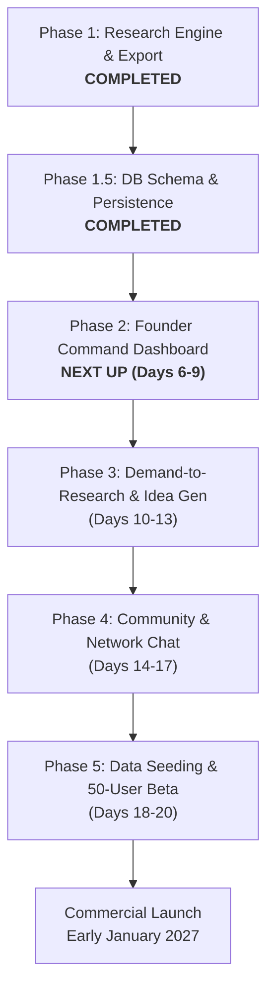

# 🗺️ Zonek / Bridgehead — Master Phase Index & Progress Audit

> **Master Engineering Roadmap:**  
> **Product:** Zonek (Bridgehead) — Ground-Truth Feasibility & Execution Engine for Entrepreneurs  
> **Sprint Schedule:** November 24, 2026 – December 14, 2026 (20-Day Build Sprint)  
> **Private Beta Launch:** December 15, 2026 (50 Free Power Users)  
> **Commercial Public Launch:** Early January 2027  
> **Audit Status Updated:** November 25, 2026 (Post Phase 1 & 1.5 Completion)

---

## 📊 Executive Phase Status Matrix

| Phase | Title | Sprint Window | Status | Completion % | Key Deliverables |
|:---:|---|:---:|:---:|:---:|---|
| **Phase 1** | **Research Engine Modularization & Dual Export Engine** | Days 1–5 | **COMPLETED** | **100%** | 5-Tab Sub-Navbar, Live Terminal, Groq 120B reasoning, Hallucination Firewall, Dual-Mode PDF/Doc Export. |
| **Phase 1.5** | **Database Schema, Persistence & User Onboarding** | Days 4–5 | **COMPLETED** | **100%** | Supabase `research_inputs` & `research_reports` tables, full evidence persistence, Saved Reports tab, Post-signup Onboarding modal. |
| **Phase 2** | **Founder Command Dashboard** | Days 6–9 | **COMPLETED** | **100%** | Dual-State UI, Highly Customizable Launch Horizon (30d/60d/90d/180d/365d/Custom), Dynamic Countdown Engine, Sprint Checklist, Budget Burn Meter. |
| **Phase 3** | **Demand-to-Research Hook & AI Idea Generator** | Days 10–13 | **PENDING** | **20%** | "Analyze This Opportunity" button on Demands, AI Idea Generator from unmet community requests, Gov Data civic polish. |
| **Phase 4** | **Lightweight Community & Direct Network Inquiries** | Days 14–17 | **PENDING** | **15%** | Supabase-backed founder discussion forum, 1-on-1 direct messaging threads, Sidebar alignment to 8 core pillars. |
| **Phase 5** | **Flagship Ground Seeding, QA & 50-User Beta** | Days 18–20 | **PENDING** | **0%** | Bangalore/Mumbai/Delhi-NCR ground data seeding, end-to-end stress testing, mobile QA, 50 Beta founders onboarding. |

---

## 🏛️ Phase-by-Phase Deep-Dive & Audit

---

### 🟢 Phase 1: Sub-Navbar & Report Modularization (Days 1–5) — **100% COMPLETED**

#### Goal & Scope:
Decompose the monolithic 1,100-line intake & report dashboard into a clean, modular 5-tab suite with live streaming telemetry and institutional-grade export tools.

#### Deliverables & Implementation Checklist:
- [x] **Modular 5-Tab Architecture:** Created [`Zonek/components/research/`](file:///d:/my%20projects/my%20projects/Zonek_Main/Zonek/components/research/):
  - [x] [`OverviewFeasibilityTab.tsx`](file:///d:/my%20projects/my%20projects/Zonek_Main/Zonek/components/research/OverviewFeasibilityTab.tsx): Strategic Verdict (GO/CAUTION/STOP), Executive Thesis, Jobs-To-Be-Done (JTBD), Hormozi Offer Architecture ($100M Offers), Peter Thiel Monopoly Moat.
  - [x] [`LocationRentalsTab.tsx`](file:///d:/my%20projects/my%20projects/Zonek_Main/Zonek/components/research/LocationRentalsTab.tsx): Physical commercial lease listings, area (sqft), rent/month, rate/sqft, verified broker/portal sources.
  - [x] [`CompetitorsLongevityTab.tsx`](file:///d:/my%20projects/my%20projects/Zonek_Main/Zonek/components/research/CompetitorsLongevityTab.tsx): Local competitors matrix, threat ratings, exploitable weaknesses, Blue Ocean ERRC grid, Porter's Five Forces, strategic positioning.
  - [x] [`FinancialBlueprintTab.tsx`](file:///d:/my%20projects/my%20projects/Zonek_Main/Zonek/components/research/FinancialBlueprintTab.tsx): Capital Reality Check, itemized Day-0 capex table with vendor sources, unit economics (CAC, LTV, Gross Margin %), 3 break-even scenarios, full 12-month Pro-Forma cash burn table.
  - [x] [`GovSchemesComplianceTab.tsx`](file:///d:/my%20projects/my%20projects/Zonek_Main/Zonek/components/research/GovSchemesComplianceTab.tsx): Matched Central/State capital subsidies (PMEGP, Mudra, CGTMSE), pre-launch statutory licensing checklist, Day-1 SOPs, operational risk register.
- [x] **Sticky Sub-Navbar Navigation:**
  - Built [`ResearchSubNavbar.tsx`](file:///d:/my%20projects/my%20projects/Zonek_Main/Zonek/components/research/ResearchSubNavbar.tsx) with active tab highlighting, verdict indicator pill, live counts (rentals, competitors, schemes), and quick Export trigger.
- [x] **Live Telemetry Research Terminal:**
  - Built [`LiveResearchTerminal.tsx`](file:///d:/my%20projects/my%20projects/Zonek_Main/Zonek/components/research/LiveResearchTerminal.tsx) showing real-time streaming progress steps (*"Scanning local commercial rentals...", "Evaluating statutory licensing requirements...", "Simulating 12-month unit economics..."*).
- [x] **AI Core & Hallucination Firewall:**
  - Switched primary LLM engine to Groq `openai/gpt-oss-120b` (120B parameter reasoning in 2–4s per module).
  - Built automated Hallucination Firewall to sanitize overconfident claims into grounded evidence.
- [x] **Dual-Engine Export Suite (PDF / HTML / Word / Markdown):**
  - Built [`ExportPdfModal.tsx`](file:///d:/my%20projects/my%20projects/Zonek_Main/Zonek/components/research/ExportPdfModal.tsx):
    - **`📝 Document This (Memorandum)`**: Institutional, bank-ready, text-first memorandum with formal Roman numerals (Section I–IX), clear H1/H2/H3 typography, zero decorative UI cards.
    - **`🎨 Download As-Is (Visual Dossier)`**: Full graphical presentation with cards, status badges, unit economics metrics, competitor attack grids, and 12-month projections.
    - **Isolated Iframe Printing Engine**: Solved the blank PDF bug by rendering into an isolated hidden iframe with standalone A4 portrait styling, eliminating Chromium DOM overflow collapse and section repetition.
    - **Multiple Output Formats**: Added 1-click **Print / Save PDF**, **Standalone HTML (.html)**, **Microsoft Word (.doc)**, and **Formatted Markdown Copy**.

#### Verification Proof:
* Production Vite frontend build: **Completed in 9.25s with 0 errors**.
* Production backend TypeScript compilation: **Completed (`tsc`) with 0 errors**.
* Git Commits: Synchronized on `master` and `main` (`5de0c6c`).

---

### 🟢 Phase 1.5: Database Schema, Persistence & User Onboarding — **100% COMPLETED**

#### Goal & Scope:
Ensure user inputs and complete research reports are permanently stored in Supabase PostgreSQL, linked to user profiles, and viewable via historical report records.

#### Deliverables & Implementation Checklist:
- [x] **Supabase Database Schema:**
  - Designed and executed [`Zonek/backend/supabase/research_schema.sql`](file:///d:/my%20projects/my%20projects/Zonek_Main/Zonek/backend/supabase/research_schema.sql):
    - `public.research_inputs`: Stores user business questionnaire answers with user foreign keys.
    - `public.research_reports`: Stores generated reports, JSONB `report_data`, verdict, generation duration, starred status.
    - Extended `public.profiles`: Added `total_budget_range`, `founder_experience`, `onboarding_completed`.
    - Row-Level Security (RLS) policies for user data isolation.
- [x] **Backend Controller & Multi-Strategy Auth:**
  - Updated [`businessResearchController.ts`](file:///d:/my%20projects/my%20projects/Zonek_Main/Zonek/backend/controllers/businessResearchController.ts):
    - Multi-strategy auth token resolution (Supabase auth verification + JWT fallback decoding).
    - Fixed 32-bit integer overflow bug on `generation_time_ms`.
    - Full evidence persistence: Attached `report.evidence` (commercial rentals, competitors, gov schemes) directly inside `report_data` so all 5 tabs load completely.
  - Built [`reportHistoryController.ts`](file:///d:/my%20projects/my%20projects/Zonek_Main/Zonek/backend/controllers/reportHistoryController.ts):
    - `GET /api/business-research/history` — Lists past reports for the authenticated user.
    - `GET /api/business-research/report/:id` — Fetches full single report.
    - `PATCH /api/business-research/report/:id/star` — Toggles favorite status.
    - `DELETE /api/business-research/report/:id` — Deletes report.
- [x] **Frontend Saved Reports History:**
  - Added **"📂 Saved Reports"** tab in [`BusinessResearch.tsx`](file:///d:/my%20projects/my%20projects/Zonek_Main/Zonek/components/BusinessResearch.tsx):
    - Lists all previous analyses with verdict badge, location, budget, and date.
    - 1-click **View Report** restoring full 5-tab state including rentals and subsidies.
    - Star/unstar and delete functionality.
- [x] **Post-Signup Onboarding Flow:**
  - Built [`OnboardingModal.tsx`](file:///d:/my%20projects/my%20projects/Zonek_Main/Zonek/components/OnboardingModal.tsx):
    - Triggers immediately after registration to collect experience level, target budget, and domain interests.
    - Persists directly to the user's `profiles` record in Supabase.

#### Verification Proof:
* Live Supabase queries verified: Reports `0804221f-d8fe-4b2f-a66a-38b4cf1e7280` and `5da7df52-7e25-42d4-938d-62a7c3d8bd5f` successfully stored with complete evidence data.
* Frontend & Backend builds verified: 0 compile errors.

---

### 🟢 Phase 2: Founder Command Dashboard (Days 6–9) — **100% COMPLETED**

#### Goal & Scope:
Transform the app from a one-off report generator into a daily habit retention engine. Empower founders with a **highly customizable launch horizon** (not constrained to 90 days—customizable for 30d popups, 60d retail, 90d cafes, 180d SaaS/gyms, 365d manufacturing, or custom calendar dates) with live milestone calibration, daily execution checklists, and capital burn tracking.

#### Deliverables & Implementation Checklist:
- [x] **Dual-State Engine (`Zonek/components/Dashboard.tsx`):**
  - **State A (Zero-Friction Venture Launchpad):**
    - Instant venture intake (Business Type, Target City/Location, Available Budget, Target Launch Horizon selector).
    - 1-click jump to full ground-truth research pre-populating all variables.
  - **State B (Customizable Founder Command Center):**
    - Active venture header with Feasibility Verdict badge (`GO`, `CAUTION`, `STOP`), business name, location, and capital.
    - Switcher to seamlessly cycle between multiple saved research reports.
- [x] **Customizable Launch Horizon & Countdown Engine:**
  - Dynamic timeline selector supporting fast presets (30 Days, 60 Days, 90 Days, 180 Days, 365 Days) and custom target calendar date (`<input type="date">`).
  - Live digital countdown ticker (`DAYS`, `HOURS`, `MINS`, `SECS`) refreshing every 1 second.
  - Visual progress bar showing elapsed time percentage vs. total horizon.
- [x] **Proportional Milestone Sprint Windows:**
  - Dynamically divides any chosen duration into 4 calibrated execution milestones:
    1. *Phase 1: Validation & Clearances*
    2. *Phase 2: Capex & Fit-Out / Sourcing*
    3. *Phase 3: Brand & Soft Launch*
    4. *Phase 4: Public Opening & Scaling*
  - Automatically highlights the active milestone sprint based on current day offset.
- [x] **Interactive Execution Checklist:**
  - Dynamically populates prioritized tasks directly from the research report (licensing requirements, capex procurement, Day-1 SOPs, 90-day sprints).
  - Category filter pills (*All, Setup, Licensing, Operations, Marketing, Sourcing*).
  - Task completion toggle with progress bar and completion count.
  - Custom task creation and deletion modal.
  - Persistent state in browser `localStorage` keyed by `zonek_tasks_<reportId>`.
- [x] **Live Budget Burn & Cash Runway Meter:**
  - Displays Total Allocated Capital, Estimated Day-0 Capex, Working Capital Buffer (with surplus/deficit warning), and Operating Runway (Months).
- [x] **Ground Intelligence Quick-View Cards:**
  - Instant summary cards for Central/State Subsidies (PMEGP, Mudra), Commercial Rental benchmarks in target location, and Competitor Blue Ocean strategy.
- [x] **Integrated Actions & Cross-Component Navigation:**
  - Direct 1-click **"Open 5-Tab Dossier"** button pre-loading report into `BusinessResearch.tsx`.
  - In-place **"Export PDF"** button triggering institutional memorandum or visual dossier export.
- [x] **System-Wide Navigation Integration:**
  - Added `View.DASHBOARD` to [`types.ts`](file:///d:/my%20projects/my%20projects/Zonek_Main/Zonek/types.ts).
  - Registered `Dashboard` in [`App.tsx`](file:///d:/my%20projects/my%20projects/Zonek_Main/Zonek/App.tsx).
  - Added "Command Center" in [`Sidebar.tsx`](file:///d:/my%20projects/my%20projects/Zonek_Main/Zonek/components/Sidebar.tsx) navigation.
  - Added "Command Center" in [`Header.tsx`](file:///d:/my%20projects/my%20projects/Zonek_Main/Zonek/components/Header.tsx) and `ProfileDropdown`.
  - Added high-visibility "⚡ LAUNCH COMMAND CENTER" hero CTA in [`Home.tsx`](file:///d:/my%20projects/my%20projects/Zonek_Main/Zonek/components/Home.tsx).

#### Verification Proof:
* Production Vite frontend build: **Completed in 15.10s with 0 errors**.
* Production backend TypeScript compilation: **Completed (`tsc`) with 0 errors**.
* Git Commits: Synchronized on `master` and `main`.

---

### ⚪ Phase 3: Demand-to-Research Hook & AI Idea Generator (Days 10–13) — **PENDING**

#### Goal & Scope:
Connect unmet community demand requests directly into the research engine and build an AI generator that synthesizes viable business ideas from neighborhood data.

#### Planned Deliverables:
- [ ] **1-Click "Analyze This Opportunity" Button:**
  - In [`Demands.tsx`](file:///d:/my%20projects/my%20projects/Zonek_Main/Zonek/components/DemandCard.tsx) / [`DemandFeed.tsx`](file:///d:/my%20projects/my%20projects/Zonek_Main/Zonek/components/DemandFeed.tsx), add a high-visibility CTA on every community demand post.
  - Clicking pre-populates the Business Type, Location, and Problem in `BusinessResearch.tsx` and starts the research flow in 1 click.
- [ ] **AI Idea Generator (`Zonek/components/IdeaGenerator.tsx`):**
  - Input: Target City / Neighborhood + Total Available Budget.
  - Engine scans local unmet demand posts and commercial rent benchmarks to generate 3–5 viable business concepts with calculated feasibility scores.
- [ ] **Commercial Rentals Deep Linking:**
  - Connect `Rentals.tsx` directly to the `LocationRentalsTab.tsx` so users can filter spaces matching their exact square footage and budget.
- [ ] **Gov Data ("For The People") Civic Portal Polish:**
  - Enhance [`GovData.tsx`](file:///d:/my%20projects/my%20projects/Zonek_Main/Zonek/components/GovData.tsx) with instant search for central/state subsidies, mandi prices, and weather trends.

---

### ⚪ Phase 4: Lightweight Community & Direct Inquiries (Days 14–17) — **PENDING**

#### Goal & Scope:
Replace deprecated legacy Socket.io prototypes with lightweight, high-performance Supabase-backed peer discussion boards and 1-on-1 direct inquiry messaging.

#### Planned Deliverables:
- [ ] **Founder Discussion Forum (`Zonek/components/CommunityHub.tsx`):**
  - Supabase-backed question/answer threads categorized by:
    1. *Licensing & Legal* (FSSAI, GST, Trade License questions)
    2. *Vendors & Equipment* (Local Indian machinery, packaging, raw material suppliers)
    3. *Commercial Spaces* (Landlord reviews, high-street vs mall negotiations)
    4. *Growth & Customer Acquisition* (Local marketing tactics)
- [ ] **Direct Network Inquiries (`Zonek/components/NetworkChat.tsx`):**
  - 1-on-1 direct messaging threads between founders and commercial landlords or suppliers.
  - Real-time message synchronization via Supabase Realtime channels.
- [ ] **Navigation Cleanup:**
  - Remove deprecated generic `Feed` view and align [`Sidebar.tsx`](file:///d:/my%20projects/my%20projects/Zonek_Main/Zonek/components/Sidebar.tsx) strictly to the 8 Core Product Pillars.

---

### ⚪ Phase 5: Flagship Ground Seeding, QA & Beta Launch (Days 18–20) — **PENDING**

#### Goal & Scope:
Pre-seed real ground data for flagship hubs, execute comprehensive end-to-end QA, and onboard the first 50 private beta founders.

#### Planned Deliverables:
- [ ] **Flagship Hub Ground Data Seeding:**
  - Pre-populate 500+ commercial rental listings and competitor density profiles across **Bangalore, Mumbai, and Delhi-NCR**.
- [ ] **End-to-End Stress Testing & Audit:**
  - Token burn and cost-per-report profiling on Groq.
  - Mobile responsiveness verification across iOS Safari and Android Chrome.
  - Zero-hallucination firewall verification across 50 simulated business types (Retail, F&B, Healthcare, D2C, Services, SaaS).
- [ ] **Private Beta Launch:**
  - Onboard 50 selected founders with 100% Free Pro Tier access on December 15, 2026.
  - Establish automated user feedback logging and error tracking.

---

## 📅 Roadmap Timeline Summary

---

## 🎯 Immediate Next Step: Phase 2 Action Plan

To initiate **Phase 2**, we will build:
1. **`Zonek/components/Dashboard.tsx`**: Dual-State Founder Command Dashboard.
2. **State A (New Visitor Launchpad)**: Zero-friction intake hero.
3. **State B (Returning Founder Command Center)**: 90-day launch countdown clock, checkable daily sprint tasks from roadmap, and budget burn meter.
4. **`App.tsx` Routing**: Set `Dashboard` as primary authenticated view.
